# Atlas-05: CI/CD with GitHub Actions + OIDC Workload Identity Federation

> **Project 5 of 11** in the [Atlas Platform Portfolio](https://github.com/manoj-2606) — a production-grade Azure cloud engineering portfolio targeting Senior DevOps/Platform Engineer roles in Europe.

## Problem

Most CI/CD pipelines authenticate to cloud providers using stored secrets — client secrets, service principal passwords, or certificates. These credentials:
- Can leak via logs, artifacts, or misconfigured variable groups
- Must be rotated manually (or forgotten until they expire in production)
- Create a blast radius — anyone with the secret has full access until revoked
- Violate zero-trust principles

## Solution

This project replaces stored credentials with **OIDC Workload Identity Federation**. GitHub Actions authenticates to Azure via a token exchange — no secrets stored anywhere. The trust itself is provisioned by Terraform, making identity infrastructure as code.

The same CI/CD pipeline from [P4 (Azure DevOps)](https://github.com/manoj-2606/atlas-04-ado-pipeline) is rebuilt on GitHub Actions, proving platform range across both major CI/CD systems used in European DevOps shops.

## Architecture

### OIDC Token Exchange Flow

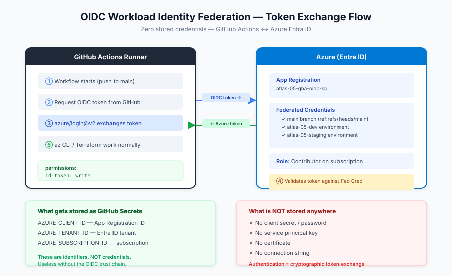

**What gets stored as GitHub Secrets (IDs, not credentials):**
- `AZURE_CLIENT_ID` — App Registration's client ID
- `AZURE_TENANT_ID` — Entra ID tenant ID
- `AZURE_SUBSCRIPTION_ID` — Azure subscription ID

**What is NOT stored anywhere:**
- No client secret / password
- No service principal key
- No certificate
- No connection string

The authentication is a cryptographic token exchange. GitHub proves *"I am a workflow running in `manoj-2606/atlas-05-gha-oidc` on the `main` branch"* and Azure responds *"I trust that exact context, here's a short-lived token."*

### Two-Phase Architecture

The chicken-and-egg problem: GHA needs OIDC to talk to Azure, but creating OIDC requires talking to Azure. Solution: two-phase Terraform with separate state.

```
Phase 1: OIDC Bootstrap (ADO → MI-ADO-API)        Phase 2: Infrastructure (GHA → OIDC)
┌─────────────────────────────────────┐            ┌─────────────────────────────────┐
│ terraform/oidc/                     │            │ terraform/infra/                │
│   App Registration                  │ ────────→  │   AKS cluster (1 node B2s)      │
│   3 Federated Credentials           │  enables   │   ACR (Basic SKU)               │
│   Contributor Role Assignment       │            │   VNet + Subnet                 │
│                                     │            │   Resource Group                │
│ State: atlas-05-oidc.tfstate        │            │ State: atlas-05.tfstate         │
│ Run from: ADO (one-time)            │            │ Run from: GitHub Actions        │
└─────────────────────────────────────┘            └─────────────────────────────────┘
```

Separate state files = independent lifecycle. Infrastructure can be created and destroyed 20 times without re-bootstrapping OIDC.

### CI/CD Pipeline Flow

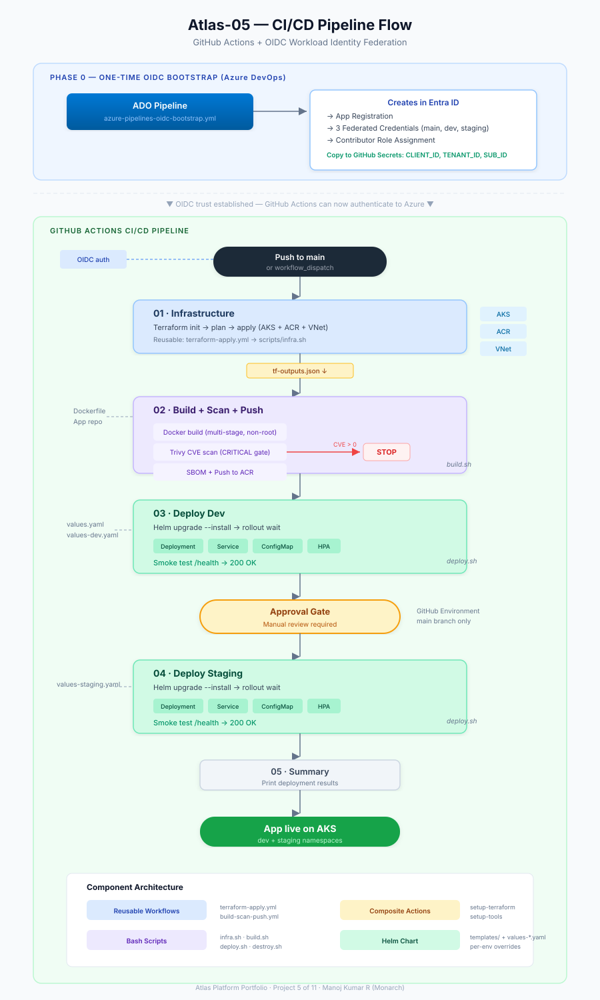

### GitHub Actions Component Model

```
.github/
├── actions/                          COMPOSITE ACTIONS (step-level)
│   ├── setup-terraform/              Install Terraform 1.9.8
│   └── setup-tools/                  Install Trivy + Helm + kubectl
│
└── workflows/
    ├── deploy.yml                    ORCHESTRATOR (thin — just wires jobs)
    ├── destroy.yml                   MANUAL TEARDOWN (workflow_dispatch)
    └── reusable/                     REUSABLE WORKFLOWS (job-level)
        ├── terraform-apply.yml       TF init → plan → apply → artifact
        ├── build-scan-push.yml       Docker → Trivy → SBOM → ACR
        ├── helm-deploy.yml           Helm → rollout → smoke test
        └── terraform-destroy.yml     TF destroy → verify
```

**Composite Actions vs Reusable Workflows:**

| Aspect | Composite Actions | Reusable Workflows |
|---|---|---|
| Scope | Step-level (injected into caller's job) | Job-level (own runner, own workspace) |
| Use case | Tool setup, common step sequences | Complete pipeline stages |
| Workspace | Shared with caller | Clean — needs own `actions/checkout` |
| Secrets | Inherited from caller's job | Must pass `secrets: inherit` |
| Analogy | Functions | Microservices |

## Repo Structure

```
atlas-05-gha-oidc/
├── terraform/
│   ├── oidc/                            Phase 1: OIDC bootstrap (ADO)
│   │   ├── main.tf                      App Reg + 3 Federated Creds + Role
│   │   ├── variables.tf
│   │   └── outputs.tf                   → GitHub Secrets
│   └── infra/                           Phase 2: AKS + ACR (GHA)
│       ├── main.tf                      Calls atlas-infra-base module
│       ├── variables.tf
│       ├── outputs.tf
│       └── environments/
│           ├── dev.tfvars
│           └── staging.tfvars
│
├── Dockerfile                           Multi-stage, non-root, <100MB
│
├── charts/
│   └── atlas-platform/                  Helm chart
│       ├── Chart.yaml
│       ├── values.yaml                  Defaults
│       ├── values-dev.yaml              Dev overrides
│       ├── values-staging.yaml          Staging overrides (2 replicas, HPA)
│       └── templates/
│           ├── _helpers.tpl
│           ├── deployment.yaml          Non-root, probes, resource limits
│           ├── service.yaml
│           ├── configmap.yaml
│           └── hpa.yaml
│
├── .github/
│   ├── actions/
│   │   ├── setup-terraform/action.yml   Composite: install TF 1.9.8
│   │   └── setup-tools/action.yml       Composite: Trivy + Helm + kubectl
│   └── workflows/
│       ├── deploy.yml                   Main CI/CD orchestrator
│       ├── destroy.yml                  Manual destroy (workflow_dispatch)
│       └── reusable/
│           ├── terraform-apply.yml
│           ├── build-scan-push.yml
│           ├── helm-deploy.yml
│           └── terraform-destroy.yml
│
├── scripts/                             Bash (P3/P4 used PowerShell)
│   ├── infra.sh                         TF init + plan + apply + outputs
│   ├── build.sh                         Docker + Trivy + SBOM + ACR push
│   ├── deploy.sh                        Helm upgrade + rollout + smoke test
│   └── destroy.sh                       TF destroy + verify
│
├── azure-pipelines-oidc-bootstrap.yml   ADO: one-time OIDC setup
│
├── docs/
│   ├── oidc-flow.svg                    OIDC token exchange diagram
│   ├── pipeline-flow.svg                CI/CD pipeline flow diagram
│   ├── gha-vs-ado.md                    ADO vs GHA detailed comparison
│   └── (screenshots after deployment)
│
├── .pre-commit-config.yaml              gitleaks + terraform_fmt + validate
├── .gitignore
├── logs.json                            Error tracking
└── README.md
```

## How to Run

### Prerequisites
- Azure subscription with Contributor access
- Azure DevOps project with MI-ADO-API service connection (OIDC)
- GitHub account with the repo created
- Terraform state backend: `atlastfstate2606` in `rg-atlas-tfstate`

### Phase 1: OIDC Bootstrap (one-time, from ADO)

```bash
# 1. Push code to ADO repo
git remote add ado https://dev.azure.com/manojmanojkumar2513/Atlas-Platform/_git/atlas-05-gha-oidc
git push ado main

# 2. Set ADO repo permissions (Build Service → Contribute + Bypass)

# 3. Create pipeline in ADO pointing to azure-pipelines-oidc-bootstrap.yml

# 4. Run with action=bootstrap
#    Stage 1: Creates backend RG + storage account + container (idempotent)
#    Stage 2: Terraform apply — App Registration + Federated Credentials

# 5. Copy outputs to GitHub → Settings → Secrets → Actions:
#    AZURE_CLIENT_ID, AZURE_TENANT_ID, AZURE_SUBSCRIPTION_ID
```

### Phase 2: GitHub Settings (one-time)

```bash
# 1. Create GitHub Environments:
#    - atlas-05-dev (no protection)
#    - atlas-05-staging (Required reviewers: yourself)
#    - atlas-05-destroy (Required reviewers: yourself)

# 2. Settings → Actions → General → Workflow permissions → Read and write
```

### Phase 3: Deploy (GitHub Actions)

```bash
# Manual trigger: Actions → Atlas-05 Deploy → Run workflow
# Or enable push trigger by adding branches: [main] to deploy.yml
```

### Phase 4: Destroy

```bash
# GitHub: Actions → Atlas-05 Destroy → Run workflow
#   environment: dev
#   confirm: destroy

# ADO (backend RG only): Run OIDC bootstrap pipeline with action=destroy
#   Note: This deletes backend storage only. App Registration stays intact.
```

### State Lock Recovery

```bash
# If Terraform state is locked:
az storage blob lease break \
  --blob-name atlas-05.tfstate \
  --container-name tfstate \
  --account-name atlastfstate2606

# For OIDC state:
az storage blob lease break \
  --blob-name atlas-05-oidc.tfstate \
  --container-name tfstate \
  --account-name atlastfstate2606
```

## Federated Credentials — Deep Dive

Each federated credential trusts a specific GitHub context. No wildcard — production-grade.

| Credential | Subject | When Used |
|---|---|---|
| `github-main-branch` | `repo:manoj-2606/atlas-05-gha-oidc:ref:refs/heads/main` | Push to main (CI/CD trigger) |
| `github-env-dev` | `repo:manoj-2606/atlas-05-gha-oidc:environment:atlas-05-dev` | Deploy to dev environment |
| `github-env-staging` | `repo:manoj-2606/atlas-05-gha-oidc:environment:atlas-05-staging` | Deploy to staging (after approval) |

**Why 3 credentials instead of `repo:*` wildcard:**
- Least-privilege — each context gets only the access it needs
- Auditable — Azure logs show which credential was used
- Revocable — disable staging deploys without affecting dev
- Interview-ready — demonstrates security-first thinking

## DevSecOps — Baked In

| Practice | Implementation |
|---|---|
| Secrets scanning | gitleaks pre-commit hook — secrets never reach Git |
| OIDC authentication | Zero stored credentials — the star of P5 |
| Image scanning | Trivy — zero CRITICAL CVEs reach ACR |
| SBOM generation | `trivy --format spdx-json` — full supply chain visibility |
| Non-root containers | `runAsUser: 1000`, `runAsNonRoot: true` |
| SA token disabled | `automountServiceAccountToken: false` |
| Privilege escalation | `allowPrivilegeEscalation: false`, `capabilities.drop: [ALL]` |

## FinOps — Baked In

| Practice | Implementation |
|---|---|
| Cost tags | Every resource: project, environment, team, cost-center, created-by, managed-by, destroy-by |
| Right-sizing | Standard_B2s nodes (~$0.04/hr), Basic ACR (~$0.17/day), 30GB OS disks |
| Ephemeral infra | Created and destroyed same day — `destroy-by: end-of-day` tag |
| Estimated cost | ~₹50 per execution day |

## Cost

| Resource | Cost/Day |
|---|---|
| AKS control plane | Free |
| 1x Standard_B2s node | ~₹3.50 (~$0.04/hr × 8hr) |
| ACR Basic | ~₹14 (~$0.17/day) |
| VNet / NSG | Free |
| GitHub Actions | Free (2,000 min/month for public repos) |
| App Registration + OIDC | Free (Entra ID — no charge) |
| **Total** | **~₹50 per execution** |

## Evidence

<!-- POST-EXECUTION: Replace placeholders with actual screenshots -->

**OIDC Bootstrap — ADO pipeline passed (Backend Storage → OIDC Provision):**

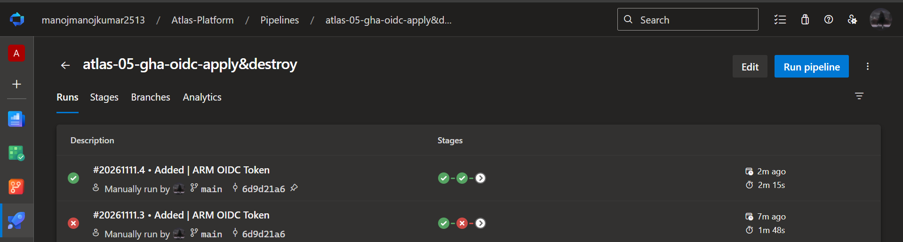
<!-- screenshot: ADO pipeline run showing both stages green -->

**OIDC Outputs — Client ID, Tenant ID, Subscription ID displayed:**

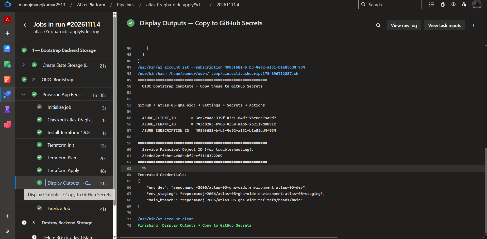
<!-- screenshot: ADO pipeline output showing the 3 values to copy to GitHub -->

**GitHub Secrets — 3 OIDC values configured:**

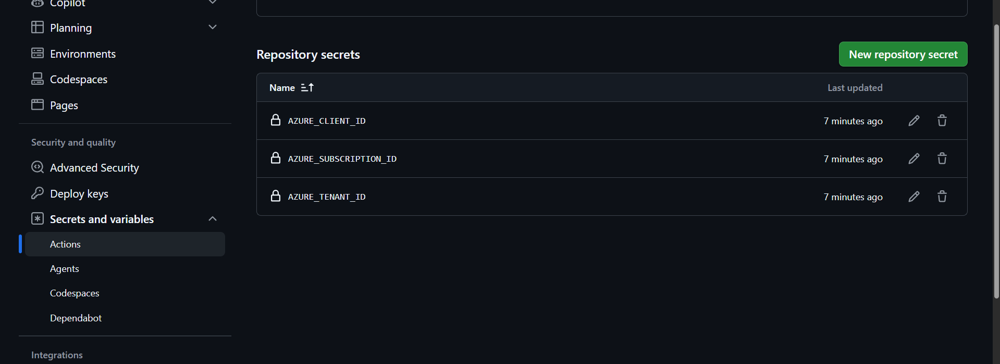
<!-- screenshot: GitHub → Settings → Secrets → Actions showing 3 secrets -->

**GitHub Environments — dev, staging, destroy configured:**

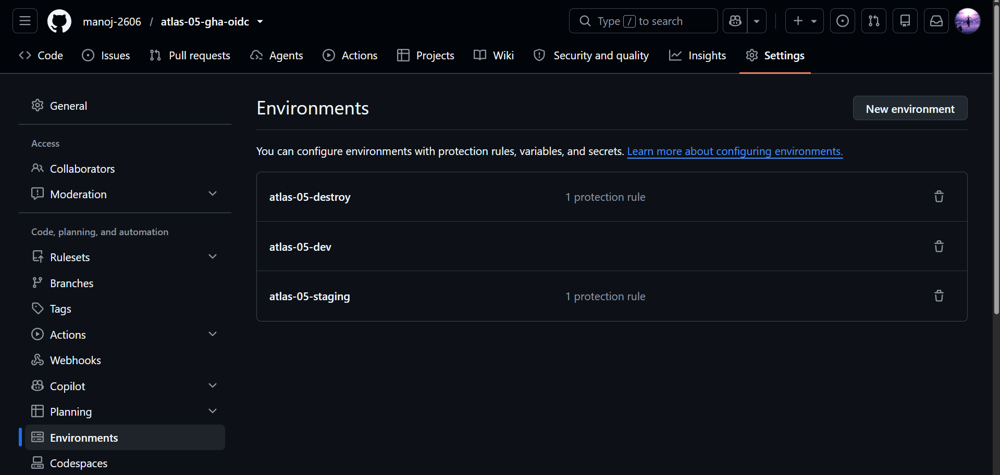
<!-- screenshot: GitHub → Settings → Environments showing 3 environments -->

**Pipeline — all 5 jobs passed (Infra → Build → Deploy Dev → Deploy Staging → Summary):**

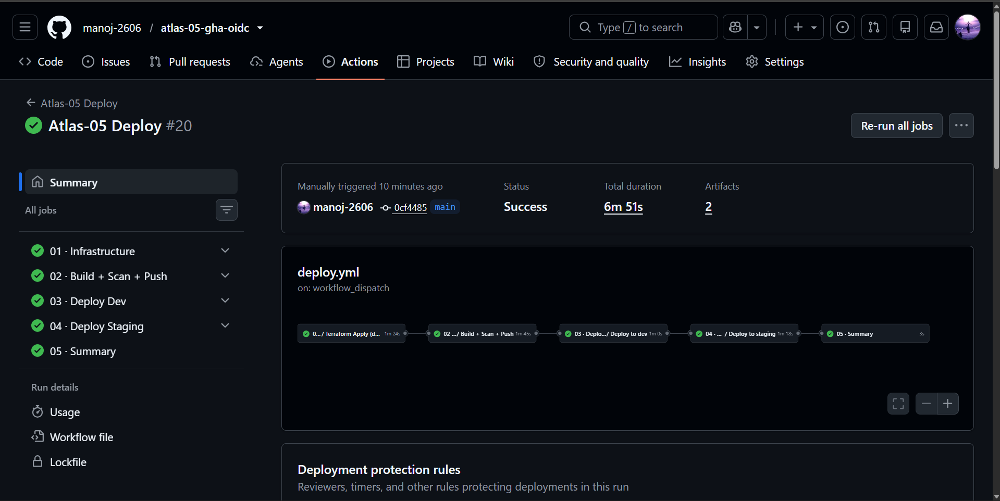
<!-- screenshot: GHA workflow run showing all jobs green -->

**Trivy scan — zero CRITICAL CVEs, SBOM generated, image pushed to ACR:**

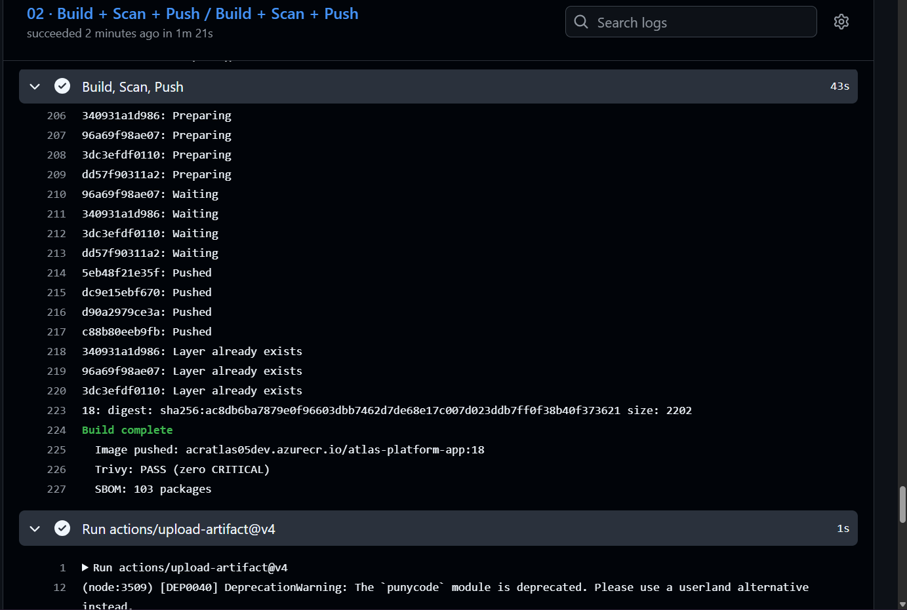
<!-- screenshot: Build job logs showing Trivy scan results -->

**ACR — image pushed with build tag:**

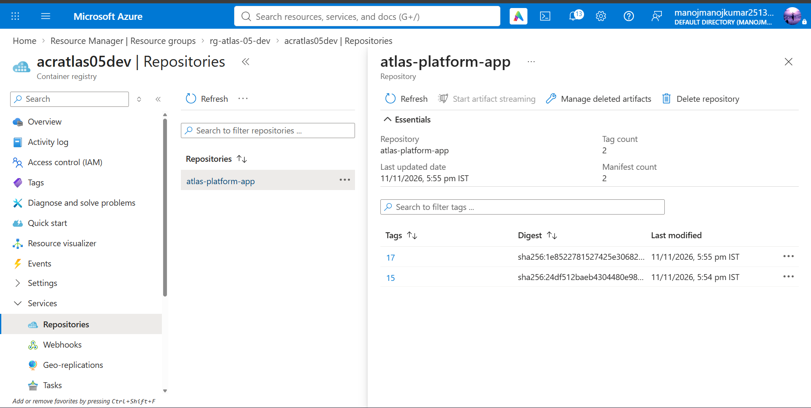
<!-- screenshot: Azure Portal → ACR → Repositories showing tagged image -->

**Deploy Dev — Helm upgrade + smoke test /health → 200 OK:**

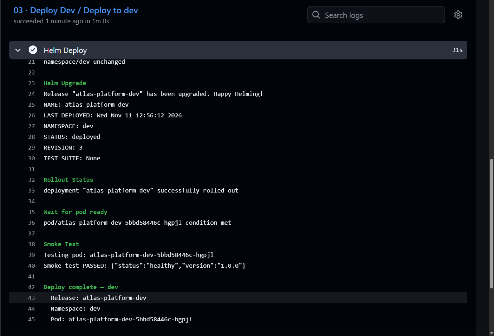
<!-- screenshot: Deploy Dev job logs showing smoke test PASSED -->

**Approval gate — staging requires manual review (main branch only):**

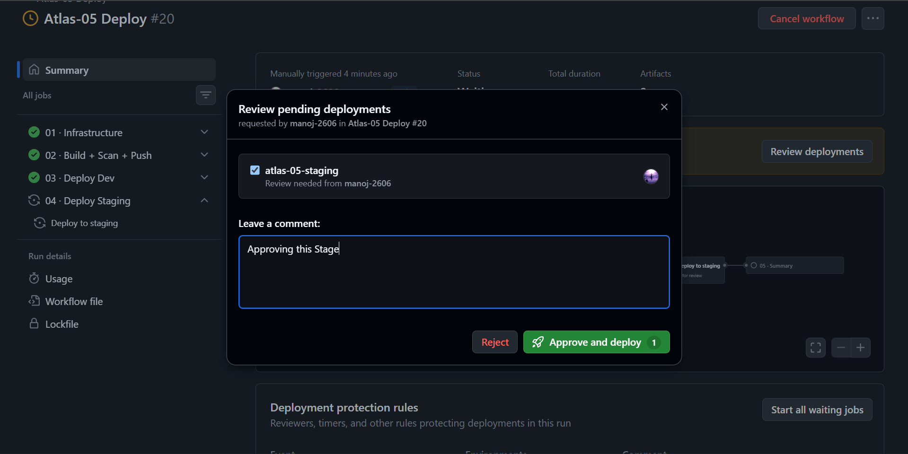
<!-- screenshot: GHA showing "Waiting for review" on staging deploy -->

**Deploy Staging — Helm upgrade + smoke test → 200 OK:**

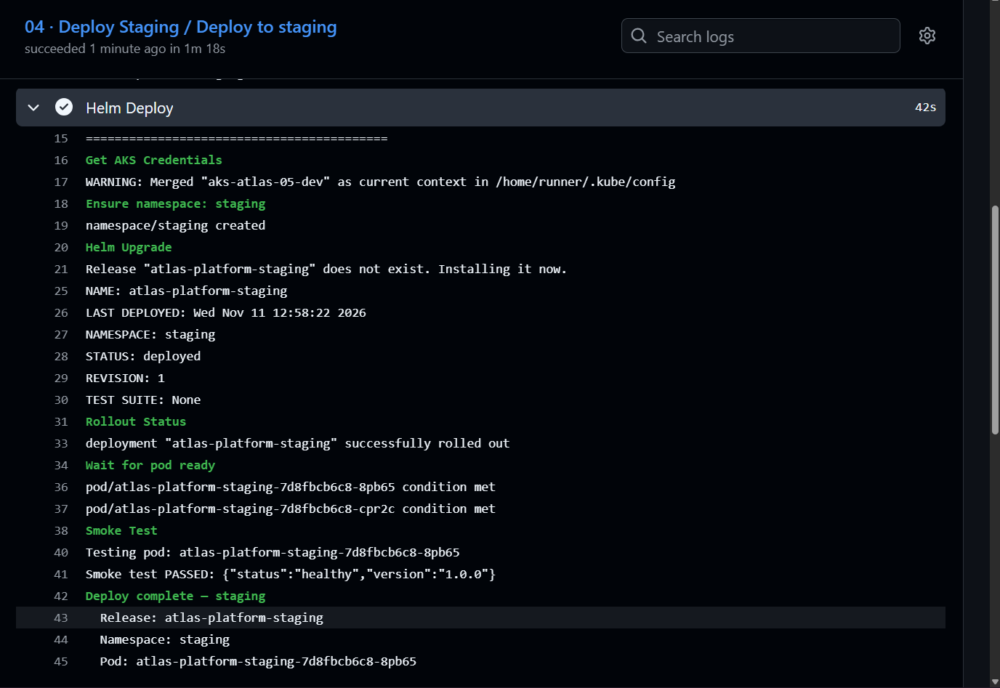
<!-- screenshot: Deploy Staging job logs showing smoke test PASSED -->

**Multi-env — pods running in both namespaces, correct replica counts:**

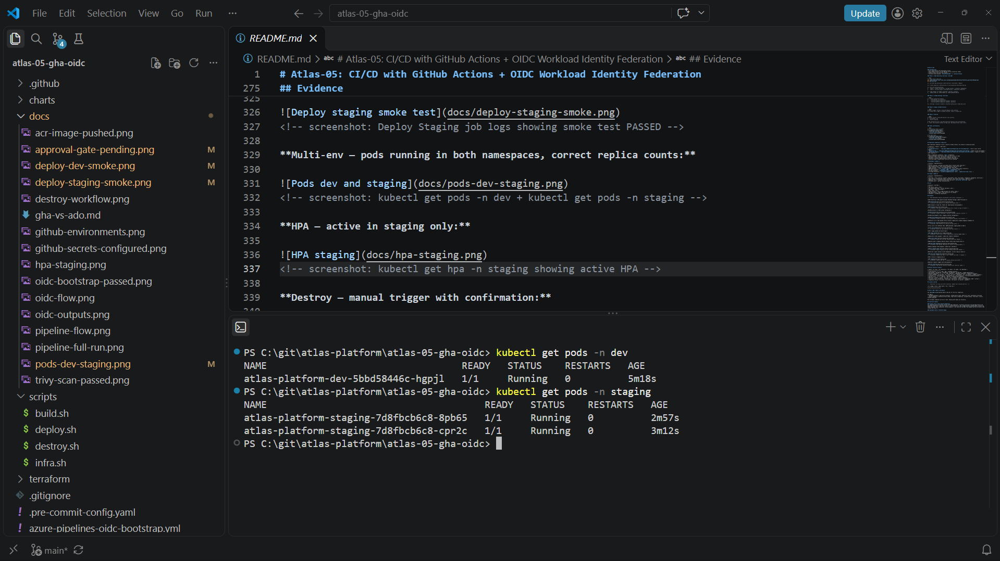
<!-- screenshot: kubectl get pods -n dev + kubectl get pods -n staging -->

**HPA — active in staging only:**

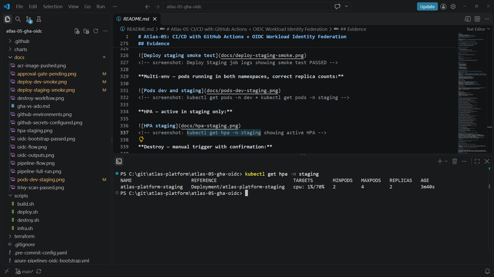
<!-- screenshot: kubectl get hpa -n staging showing active HPA -->

**Destroy — manual trigger with confirmation:**

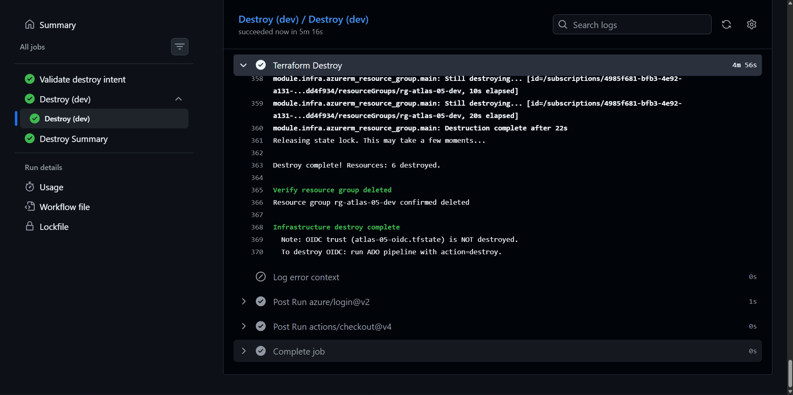
<!-- screenshot: GHA destroy workflow dispatch with "destroy" typed -->

## Versus Previous Projects

| Aspect | P1 (IaC) | P2 (Container) | P3 (Helm) | P4 (ADO) | P5 (GHA+OIDC) |
|---|---|---|---|---|---|
| CI/CD Platform | — | — | ADO | ADO | **GitHub Actions** |
| Auth Method | MI-ADO-API | MI-ADO-API | MI-ADO-API | MI-ADO-API | **OIDC Federation** |
| Reusable Components | — | — | — | YAML templates | **Reusable workflows + composite actions** |
| Script Language | Inline Bash + PS | Bash .sh files | PowerShell .ps1 | PS helpers | **Bash scripts** |
| Artifacts | — | PublishPipeline | PublishPipeline | PublishPipeline | **actions/upload-artifact** |
| Approval Gates | — | — | ADO Env | ADO Env | **GitHub Environments** |
| Multi-Env | Single | Single | dev only | dev → staging | **dev → staging** |
| Terraform State | Shared key | Shared key | Shared key | Shared key | **Separate: OIDC + infra** |
| Credentials Stored | SC secret | SC secret | SC secret | SC secret | **Zero** |

## Lessons Learned

<!-- Populated from logs.json after execution. Update this section post-run. -->

| # | Stage | Error | Root Cause | Fix | Time Lost |
|---|---|---|---|---|---|
| — | — | — | — | — | — |

## GHA vs ADO — When to Use Which

See [docs/gha-vs-ado.md](docs/gha-vs-ado.md) for the full comparison.

**TL;DR:**
- **GitHub Actions** — open-source projects, GitHub-native teams, OIDC-first auth, marketplace ecosystem
- **Azure DevOps** — enterprise Azure shops, tight Azure integration, variable groups + Key Vault, classic release pipelines

Most European companies use one or both. Knowing both makes you versatile.

## Interview Summary

### Primary Story — Zero Stored Credentials
*"I replaced service principal secrets with OIDC federation. Terraform provisions the App Registration and Federated Credential — the trust itself is infrastructure as code. GitHub Actions authenticates to Azure via token exchange. Zero credentials stored anywhere. I can show you the OIDC flow diagram and the Terraform that creates the trust."*

### Secondary Story — Platform Range
*"I've built the same CI/CD pipeline on both Azure DevOps (P4) and GitHub Actions (P5). I know when to use which, and I can compare their reusable workflow patterns, secret management, and approval gate implementations side by side."*

### Questions This Project Answers
- How does OIDC token exchange work between GitHub and Azure?
- Why 3 federated credentials instead of a wildcard?
- What's the difference between composite actions and reusable workflows?
- How do you handle the chicken-and-egg problem for OIDC bootstrap?
- Why separate Terraform state for OIDC vs infrastructure?
- How do GitHub Environments compare to ADO Environments for approval gates?
- Why Bash in P5 when P4 used PowerShell?

## Related Projects

| Project | Focus | Repo |
|---|---|---|
| P1 — IaC Foundation | Terraform + AKS from scratch | [atlas-01-iac-foundation](https://github.com/manoj-2606/atlas-01-iac-foundation) |
| P2 — Container Security | Docker + Trivy + SBOM | [atlas-02-container-security](https://github.com/manoj-2606/atlas-02-container-security) |
| P3 — Helm Deployment | Helm charts + AKS deployment | [atlas-03-helm-deployment](https://github.com/manoj-2606/atlas-03-helm-deployment) |
| P4 — Pipeline Mastery | YAML templates + multi-env CI/CD (ADO) | [atlas-04-pipeline-mastery-ado](https://github.com/manoj-2606/atlas-04-pipeline-mastery-ado) |
| **P5 — GHA + OIDC** | **GitHub Actions + OIDC Federation** | **atlas-05-gha-oidc** |

---

**Built by [Manoj Kumar R](https://github.com/manoj-2606) — Atlas Platform Portfolio**
**Target: Senior DevOps / Platform Engineer — Netherlands | Finland | Sweden | Ireland**